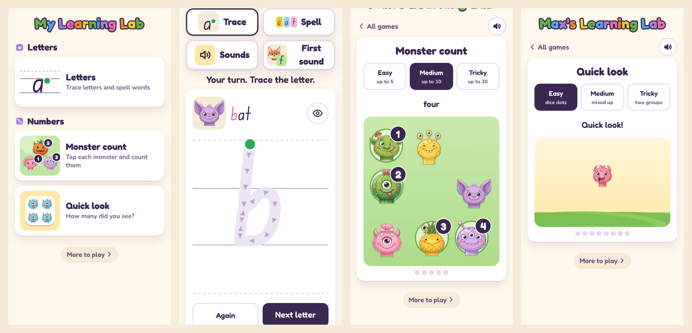

# Learning Lab

Learning games for my daughter, starring the 30 monsters from her [Monster Book](https://github.com/mikeohallo/monster-book). Live at [learn.mikeohalloran.au](https://learn.mikeohalloran.au/), one of three labs behind [play.mikeohalloran.au](https://play.mikeohalloran.au/): Monster Lab, Learning Lab and Seek Lab.



## The games

**Numbers**, for everyone:

- **Monster count.** A field of different monsters. Tap each one to count it: it gets a number badge and the narrator counts along, and tapping one twice doesn't count it again. After the last one, "How many monsters?" and three numbers to choose from. A wrong answer lights up the last badge, because the last number you count is how many there are. Up to 5, 10 or 20.
- **Quick look.** A few of the same monster pop up for a moment, then duck behind a bush. How many were there? Seeing a small amount at a glance without counting is called subitising, and it's one of the building blocks of early maths. Dice patterns first, then mixed up, then two groups side by side (four and three make seven).
- **Feed the monster.** A monster wants some cookies: the number, and that many dots, in a thought bubble. Tap the jar to put cookies on its plate, counted aloud as they land; tap one to take it off. The plate is a ten frame, two rows of five, so the amount shows at a glance as well as by counting. Too few and it's still hungry, too many and it asks you to take some away. On Tricky the plate already has some, and the monster wants one more or one less, so she counts on from what's there.
- **More or less.** Two groups of monsters: which side has more? A wrong answer counts both sides out loud, a number on each monster, then asks again. On Medium each side's monsters fill their mat, so the side with fewer has bigger monsters and looks just as full: she has to count, not judge by eye. Tricky has groups only one or two apart, and sometimes asks which side has fewer.
- **Monster train.** A train pulls in with four numbered carriages, a monster peeking out of each, and one carriage empty. The narrator reads along as each carriage lights up; which number goes in the gap? A monster hops in and the train toots off. A wrong answer counts along to the gap. What comes next, then what's missing in the middle, then up to 20 with what comes before and counting down.
- **Jump in the bed.** "Three monsters on the bed. Two more jump on!" How many on the bed now? The ones jumping on are a different monster, so the three and the two stay easy to see: adding, without calling it adding. On Tricky some roll off instead, which is taking away. A wrong answer counts the bed, a number on each monster, and Watch again tells the story again.

**Letters**, on Sam's phone only:

- **Trace** shows a lowercase letter in NSW Foundation Style, the handwriting NSW schools teach, and a ghost finger draws it first. Then only the right start point, direction and stroke order count; the line gets stricter as she gets better.
- **Spell** gives her a picture and letter tiles; each tile says its sound when she taps it, and a finished word is sounded out ("f… o… x… fox!").
- **Sounds** plays a letter sound and she taps the letter that makes it: three letters that are hard to mix up, or four with one near miss (b or d?).
- **First sound** shows a picture, says the word, and she taps the letter it starts with.

Each game has its own link (`/#count`, `/#quick`, `/#feed`, `/#more`, `/#train`, `/#jump`, and `/#letters` on Sam's phone).

## How it's built

It's one HTML file, like the Monster Book's site: no framework, no build step, no server, no accounts, no analytics. Hosting is Cloudflare Pages on the free plan.

- **Two kinds of voice.** Letters uses her parents' recorded voices: her mum says the letter sounds and her dad says everything else. Numbers has a narrator made with text-to-speech, one Australian teacher's voice from Google's library. Number words are whole words, which text-to-speech does well. A letter's sound on its own (a short "b", nothing after it) came out as "bee" or "buh" in every voice we tried, and that extra "uh" is exactly what teachers train out, so those had to be recorded by a person. Every sound goes through the page's own audio, so one mute button covers everything, and a missing clip falls back to the browser's voice or to words on screen.
- **Letters is locked to one phone.** It has her parents' voices and her family's pictures, which are for her, not for everyone with the link. Cloudflare Pages runs a small script in front of the site (`tools/_worker_src.js`, deployed as `_worker.js`). Unless a browser has a pass, it answers 404 for anything under `letters/`, and the page hides the Letters tile. The pass comes from opening a secret link once on her phone: a cookie that lasts 400 days, renewed every time she plays. The key isn't in this repo.
- **It used to live inside the Monster Book's site.** When it moved out, her saved progress (which letters she has traced, the levels she picked) was on the old site, and a browser only lets a site read its own saved data. So the first time the Learning Lab opens on her phone, it hops once to the monster site, which hands the progress back in the address. The hop happens only for her copy, and the import never overwrites anything already here (`tools/test_carry.py`).
- **What she does stays on her phone.** Progress and levels are kept in the browser's own storage. Nothing is sent anywhere.
- **Not meant for search.** A `noindex` tag asks search engines not to list it.

## What's in this repo

| Path | What it is |
|---|---|
| `index.html` | The whole site: markup, styles and script in one file |
| `tools/build_site.py` | Wraps the working page for hosting and builds the lock with its key |
| `tools/_worker_src.js` | The Letters lock (the key is filled in at build time and isn't in the repo) |
| `tools/test_worker.mjs` | Tests the lock with fake requests: blocked without a pass (including disguised addresses), the secret link, renewing the pass, and `?letters=off` |
| `tools/test_letters.py` | Traces every letter a to z the way a finger would, then tries the wrong start, the wrong direction and going off the line; spells every level, including a name; plays Sounds and First sound at both levels; checks phones, a folding phone and a laptop, and that a device without the pass gets no Letters |
| `tools/test_numbers.py` | Plays all six Numbers games: counting, counting twice, wrong and right answers, peeking, too few and too many cookies, one more and one less, more and fewer, what comes next and before, counting down, jumping on and rolling off, full rounds at every level; every layout at four screen sizes with no monster overlapping or cut off, and the jar and Feed button on the first screen; the narrator's clips, the browser-voice fallback and mute; and the voice maker against a fake API, including Google's daily limit |
| `tools/test_carry.py` | The one-time move of her progress from the monster site, with both sites served under their real addresses inside the test browser |
| `tools/letters/` | The Letters tools: tracing paths from the font, the word list, a recording page, and the picture and voice tools ([its own README](tools/letters/README.md)) |
| `tools/numbers/` | The maths narrator: the lines, the text-to-speech maker and the clip processing ([its own README](tools/numbers/README.md)) |
| `letters/` | The Edu NSW ACT Foundation font the tracing game uses (Open Font Licence) |
| `docs/` | Screenshot |

The monster faces aren't in the repo; they're the book's artwork. Neither are the Letters pictures and voices, the family words, or the narrator's clips. The tests need the faces next to `index.html` to run.

## Running it locally

```
python3 -m http.server 8000
```

then open http://localhost:8000/. The page looks for its pictures and voices beside it; without them it still runs, with words on screen instead of voices.

## Credits

The monsters and the Letters pictures were generated with Google AI Studio, and the narrator's voice with Gemini text-to-speech. Fonts: [Fredoka](https://fonts.google.com/specimen/Fredoka) and [Nunito](https://fonts.google.com/specimen/Nunito); the tracing letters use [Edu NSW ACT Foundation](https://github.com/MezMerrit/AU-School-Handwriting-Fonts) by the AU School Handwriting Fonts Project (`letters/OFL.txt`). All three are Open Font Licence. Site and tools written with Claude; MIT licence for the code (`LICENSE`).

Made for my daughter.
